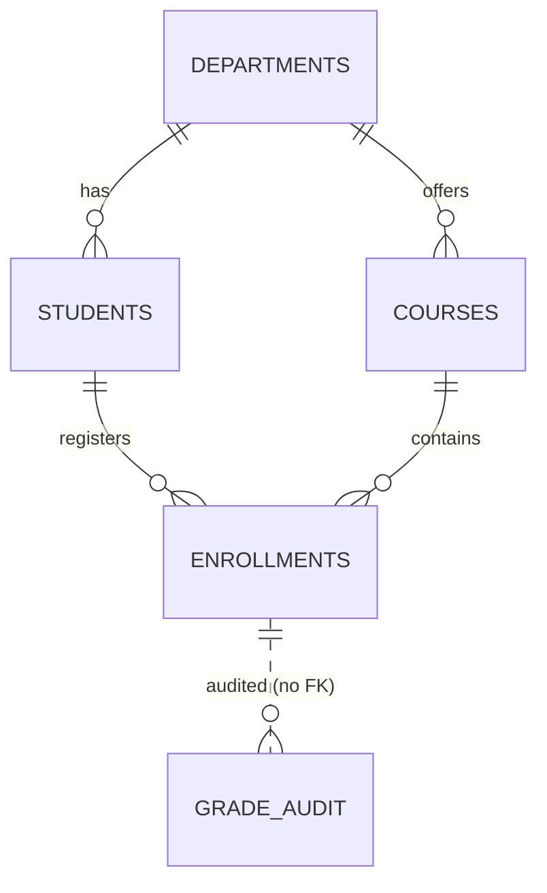

# Group Assignment IV: Advanced Oracle PL/SQL Programming

**Course:** Database Development with PL/SQL (INSY 8311)
**Instructor:** Eric Maniraguha | **Teaching Assistant:** Afanyu Emmanuel
**Application:** University Student Registration & Grading System

---

## 1. Group Members

| # | Full name | Student ID | Class group |
|---|-----------|------------|-------------|
| 1 | Michel *(add surname)* | 29055 | *(I / B / C / D)* |
| 2 | *(partner full name)* | *(partner ID)* | *(I / B / C / D)* |

**Submission deadline for our group:** *(fill in from the assignment table)*
**Repository link:** *(paste the public GitHub URL here)*

---

## 2. Application Description and Requirements

The system manages how a university registers students into courses and records their grades.

**Business requirements**

1. Students belong to a department and have a status (`ACTIVE`, `SUSPENDED`, `GRADUATED`).
2. Only `ACTIVE` students can register, only for existing courses, once per course and semester.
3. Every course has a seat limit that must never be exceeded.
4. Scores are 0-100 and are converted to a letter grade (A >= 90, B >= 80, C >= 70, D >= 60, F below 60).
5. Every grade change is written to an audit table.
6. Only ungraded enrollments can be dropped.
7. Staff can enrol a whole list of students at once, apply a grade curve to a whole class, and print rosters and transcripts.
8. GPA is credit-weighted on a 4.0 scale.

### Database schema (ERD)



| Table | Purpose | Key constraints |
|-------|---------|-----------------|
| `DEPARTMENTS` | Academic departments | PK, unique name |
| `STUDENTS` | Student master data | PK, unique email, FK to departments, CHECK on status |
| `COURSES` | Course catalogue | PK, unique code, FK to departments, CHECK credits 1-6, CHECK capacity > 0 |
| `ENROLLMENTS` | Student-course-semester registrations and grades | PK (identity), FKs to students and courses, UNIQUE(student, course, semester), CHECK score 0-100, CHECK grade letter |
| `GRADE_AUDIT` | History of grade changes | PK (identity); no FK on purpose so history outlives an enrollment |
| `BULK_ERROR_LOG` | Rows rejected by `FORALL ... SAVE EXCEPTIONS` | PK (identity) |
| `PERF_TEST` | Scratch table for the bulk-vs-row benchmark | PK |

Schema-level types: `T_NUMBER_LIST` (nested table of NUMBER), `T_TOP_STUDENT_OBJ` (object), `T_TOP_STUDENT_TAB` (nested table of that object).

---

## 3. Repository Contents

```
plsql-assignment4-<studentID1>-<studentID2>/
├── README.md
├── .gitignore
├── 00_schema/
│   ├── 01_create_tables.sql          tables, constraints, collection types
│   └── 02_insert_sample_data.sql     departments, students, courses, enrollments
├── 01_procedures/
│   ├── find_student_by_lastname.sql  %ROWTYPE OUT param, NO_DATA_FOUND, TOO_MANY_ROWS
│   ├── register_student_course.sql   records, INSERT..RETURNING, user-defined exceptions
│   ├── record_grade.sql              implicit cursor: SQL%FOUND / NOTFOUND / ROWCOUNT
│   ├── drop_enrollment.sql           implicit cursor on DELETE
│   ├── print_course_roster.sql       explicit cursor OPEN / FETCH / CLOSE
│   ├── print_student_transcript.sql  cursor FOR loop, associative array
│   ├── bulk_enroll_students.sql      FORALL + SAVE EXCEPTIONS, nested table parameter
│   ├── bulk_apply_grade_curve.sql    BULK COLLECT LIMIT, FORALL UPDATE/INSERT
│   └── benchmark_bulk_vs_row.sql     row-by-row vs FORALL timing
├── 02_functions/
│   ├── calc_letter_grade.sql
│   ├── calc_student_gpa.sql
│   ├── get_course_enrollment_count.sql
│   └── get_top_students.sql          returns a collection, callable with TABLE()
├── 03_tests/
│   ├── test_success_cases.sql        12 success tests
│   └── test_error_cases.sql          23 error-handling tests (PASS/FAIL printed)
├── screenshots/                      <test_name>_output.png
└── docs/
    └── IMPLEMENTATION_NOTES.md       design, exception strategy, performance notes
```

---

## 4. How to Run

Connect to your pluggable database as your coursework user (for example `michel_plsqlauca_29055` in `mi_pdb_29055`). The user needs `CREATE TABLE`, `CREATE PROCEDURE` and `CREATE TYPE` (the `DBA` role from Assignment II covers this). Start SQL*Plus (or SQLcl / SQL Developer script runner) from the repository root:

```sql
-- 1-2. Schema and data
@00_schema/01_create_tables.sql
@00_schema/02_insert_sample_data.sql

-- 3. Functions first: several procedures call them, so they must exist before the procedures compile
@02_functions/calc_letter_grade.sql
@02_functions/get_course_enrollment_count.sql
@02_functions/calc_student_gpa.sql
@02_functions/get_top_students.sql

-- 4. Procedures
@01_procedures/find_student_by_lastname.sql
@01_procedures/register_student_course.sql
@01_procedures/record_grade.sql
@01_procedures/drop_enrollment.sql
@01_procedures/print_course_roster.sql
@01_procedures/print_student_transcript.sql
@01_procedures/bulk_enroll_students.sql
@01_procedures/bulk_apply_grade_curve.sql
@01_procedures/benchmark_bulk_vs_row.sql

-- Check that everything compiled (this must return no rows)
SELECT object_name, object_type, status FROM user_objects WHERE status <> 'VALID';

-- 5. Tests
@03_tests/test_success_cases.sql
@03_tests/test_error_cases.sql
```

> **Why functions before procedures?** The assignment lists procedures first, but `register_student_course`, `record_grade`, `bulk_enroll_students`, `bulk_apply_grade_curve` and `print_student_transcript` call functions. If the procedures are compiled first, Oracle marks them `INVALID` until the functions exist. If that happens, run `EXEC DBMS_UTILITY.COMPILE_SCHEMA(USER, FALSE);` and re-check `user_objects`.

Both test scripts end with `ROLLBACK`, so they can be re-run any number of times. If you use SQL Developer, run each file with **Run Script (F5)** so `DBMS_OUTPUT` is shown.

### Screenshots to capture (save in `screenshots/`)

One per test, named `<test_name>_output.png`, for example `S1_register_student_course_output.png` ... `S12_benchmark_output.png`, and `E1_student_not_found_output.png` ... `E23_benchmark_invalid_rows_output.png`. Also capture the clean `user_objects` check (no invalid objects) and the `bulk_error_log` query from test E18.

---

## 5. Where Each Required Concept Is Used

| Requirement | Where |
|-------------|-------|
| User-defined records | `register_student_course` (`t_seat_info`), `print_course_roster` (`t_roster_rec`), `bulk_enroll_students` (`t_err_rec`) |
| `%ROWTYPE` | `find_student_by_lastname` (OUT param), `register_student_course`, `print_student_transcript`, `bulk_enroll_students` |
| Associative arrays | `print_student_transcript` (string index), `bulk_apply_grade_curve`, `bulk_enroll_students`, `benchmark_bulk_vs_row` |
| Nested tables | `T_NUMBER_LIST` parameter in `bulk_enroll_students`; `T_TOP_STUDENT_TAB` returned by `get_top_students` |
| Implicit cursors | `record_grade` (UPDATE/INSERT), `drop_enrollment` (DELETE), `register_student_course` (INSERT) with `SQL%FOUND`, `SQL%NOTFOUND`, `SQL%ROWCOUNT` |
| Explicit cursors | `print_course_roster` (OPEN/FETCH/CLOSE), `print_student_transcript` (cursor FOR loop), `bulk_apply_grade_curve` (cursor + BULK COLLECT) |
| `BULK COLLECT` | `bulk_apply_grade_curve` (with `LIMIT`), `get_top_students`, `benchmark_bulk_vs_row` |
| `FORALL` | `bulk_enroll_students` (INSERT), `bulk_apply_grade_curve` (UPDATE + INSERT), `benchmark_bulk_vs_row` |
| Bulk DML errors | `SAVE EXCEPTIONS`, `SQL%BULK_EXCEPTIONS`, ORA-24381 in `bulk_enroll_students`; `SQL%BULK_ROWCOUNT` in `bulk_apply_grade_curve` |
| Predefined exceptions | `NO_DATA_FOUND`, `TOO_MANY_ROWS` (`find_student_by_lastname`), `DUP_VAL_ON_INDEX` (`register_student_course`) |
| User-defined exceptions | `e_course_full`, `e_student_inactive`, `e_invalid_score`, `e_already_graded`, `e_no_grades`, `e_bad_bonus`, ... |
| `RAISE_APPLICATION_ERROR` | Every procedure and function (codes -20001 to -20070, listed in `docs/IMPLEMENTATION_NOTES.md`) |

---

## 6. AI Assistance Disclosure

We used an AI assistant (Claude, by Anthropic) to help design the application, draft the SQL and PL/SQL code, and write the first version of the test scripts and documentation. *(Edit this paragraph so it honestly describes what each of you did: which parts you reviewed, changed, ran and debugged yourselves, and who wrote which commits.)* Both group members have read, run and tested all of the code, and both of us are able to explain and justify every file in this repository.

---

## 7. Submission Details

- **Repository Link:** *(GitHub URL)*
- **Group members:** Michel *(surname)* (29055) and *(partner name)* *(partner ID)*
- **Submitted via:** Google Form (https://forms.gle/T97Ay3yeKCKBYf7t8)
